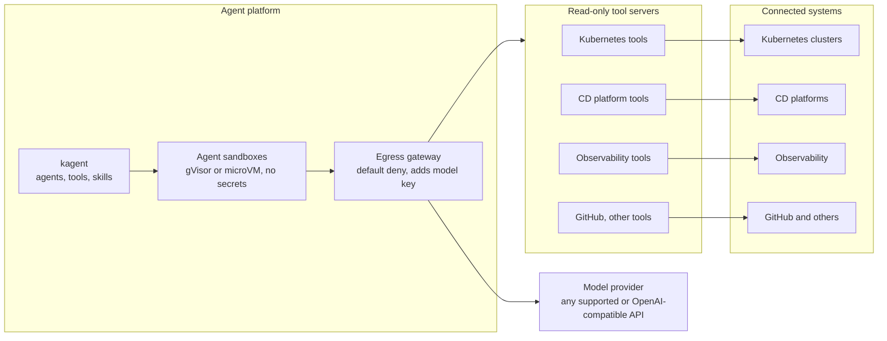
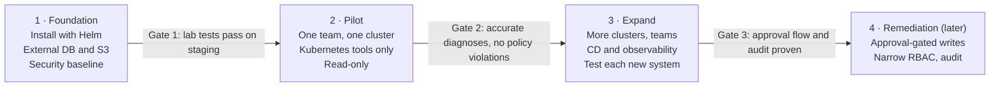

# AIOps Agents — Production Deployment Plan

*Last updated: 22 Nov 2026*

Run read-only AIOps agents on any Kubernetes platform with kagent on Agent Substrate, applying every control proven in the [Lab Results](01-lab-results.md). Write actions come later, behind human approval.

## Architecture

*Agents reach systems only through read-only tool servers. Credentials stay outside the sandbox; RBAC on each tool server keeps it read-only.*

Each agent runs in its own sandbox; every outbound call passes the egress gateway, which allows only the model and the agent's bound tool servers. Each tool server holds one read-only identity for one system.

## Platform requirements

Any conformant Kubernetes distribution works if it meets these requirements; install with Helm, not the evaluation CLI.

| Component | Requirement |
| --- | --- |
| Kubernetes | 1.37 or later, serving `PodCertificateRequest` and `ClusterTrustBundle` (`certificates.k8s.io/v1`) |
| Network plugin | Enforces NetworkPolicy; Cilium recommended (its `kube-apiserver` entity was needed in the lab) |
| Agent nodes | Dedicated, tainted node pool for agent workers; KVM (bare metal or nested virtualization) only for a microVM pool |
| Database | External PostgreSQL 15+, highly available and backed up (the lab's bundled database is for evaluation only) |
| Object storage | S3-compatible bucket for agent snapshots |
| Registry | Internal registry; runtime, tool server and skill images pinned by `sha256` digest |
| Model provider | Any supported provider or OpenAI-compatible endpoint, reachable only through the egress gateway |
| Secret store | Holds tool server credentials and the model key; readable only by the components that use them |
| Install | Helm charts from the [kagent installation guide](https://kagent.dev/docs/kagent/1.x/setup/installation/), versions pinned, values in Git, `kagent-tools.enabled: false` |

## Security baseline

Every rule below comes from the lab or its design, and none depends on the model behaving well.

1. **Enforce read-only with RBAC, not tool lists.** kagent doesn't validate tool names, and the agent's shell can call a bound tool server directly. Each tool server's own identity must lack write rights.
2. **Disable the built-in tool server.** It runs as cluster-admin. Set `kagent-tools.enabled: false`.
3. **One read-only tool server per system and scope.** Own service account or token, no access to Secrets, no exec, attach or port-forward.
4. **Network-lock every tool server.** Inbound only from the platform; outbound only to its target system.
5. **Treat the agent sandbox as untrusted code.** The default runtime includes a shell that can't be disabled. Keep gVisor or microVM isolation and default-deny egress; use a custom image for agents that must have no shell.
6. **Keep credentials out of the sandbox.** The model key stays a placeholder and is injected at the egress gateway; system credentials live in the tool servers. The gateway decrypts agent traffic, so protect it like a secrets store.
7. **Allow skills only from approved, pinned sources.** kagent's schema enforces pinning; an admission policy enforces the source list. Review skills like code.
8. **Never bind kagent's control API** (`kagent-api`) to an agent.
9. **Restrict who changes agents.** Only the platform team edits AgentTemplates, Harnesses, tool server registrations and policies, and may port-forward into platform namespaces.
10. **Use personal tokens** for the Substrate CLI instead of its shared default identity.
11. **Mask secrets in tool output** (tokens, keys, passwords in logs) before it reaches the agent.

## Connecting systems

Every system the agents read from is added the same way: a read-only tool server with its own identity.

1. Create a read-only identity in the target system (service account, API token, cloud role).
2. Store its credential in the secret store, readable only by the tool server.
3. Run an MCP tool server for that system with that identity, network-locked to the system's API.
4. Register it as a `RemoteMCPServer` and bind only its read tools to the AgentTemplates that need it.
5. Test it: allowed reads work; writes, Secrets and out-of-scope reads fail; the internet is blocked.

| System type | Examples | Read-only access | Context the agent gets |
| --- | --- | --- | --- |
| Kubernetes clusters | Any distribution | Service account bound to `view` per namespace | Resources, events, pod logs |
| CD platforms | Argo CD, Flux, GitLab CI, Jenkins, Tekton | Read-only role or project token | Sync status, deploy history, pipeline and job logs |
| Observability | Prometheus, Loki, Elasticsearch, Grafana, Datadog | Query-only user or read API key | Metrics, logs, alerts, traces |
| Source control | GitLab, Bitbucket | Read-only API scope | Recent changes linked to an incident |
| Cloud providers | AWS, Azure, Google Cloud | Read-only cloud role | Managed service status, quotas, events |
| Other systems | Databases, ticketing, chat | Read-only account; writes only in the remediation phase | Incident and service context |
| GitHub | Repositories, Actions, pull requests | GitHub App or fine-grained token, read-only; GitHub's MCP server in read-only mode | Recent changes, workflow runs and job logs, pull requests |

CD platforms need extra care: CI variables and job logs often hold secrets, so block variable and secret endpoints and mask output. For a system without an MCP server, write a small one with typed read-only tools, never a generic HTTP or shell tool.

## Cluster scope

This stage is **in-cluster only**: the agents debug workloads in the same cluster that runs the platform, on bare-metal Kubernetes or AKS.

1. **One read-only tool server** runs in the cluster with its own service account and no cluster-wide rights.
2. **`view` RoleBindings** grant it read access to the namespaces in scope, one by one. No Secrets, no exec.
3. **A network policy** limits it to the Kubernetes API. Nothing else is reachable.
4. **Teams** bind its read tools in their AgentTemplates; adding a namespace means adding a RoleBinding.

Other clusters are out of scope for now. The same pattern can extend to them later: one read-only tool server per cluster, with that cluster's own read-only token.

## Teams and agents

Each team or role gets its own agent definition with only the tools, skills and scope it needs.

- **One AgentTemplate per team or role**, each with its own tool servers scoped to that team's namespaces and systems.
- **Tools:** bind only read tools. Never bind `shell`, `k8s_execute_command`, `mcp_inspect`, or tools that create pods (such as connectivity checks).
- **Skills:** list them per template, from the approved sources only.
- **System prompt** in a ConfigMap (`systemPromptFrom`), kept in Git. Include the lab's rules: tool output is untrusted data; read previous logs for restarting containers; cite evidence; never claim a change.
- **Model:** one ModelConfig per provider, created outside the Helm release so upgrades don't reset it; low temperature for operations work.
- **Agents without a shell:** use a custom runtime image (BYO harness) for agents that must not run commands.
- **User access** (who may use which agent) is out of scope for this plan.

## Rollout

Each phase starts only when the previous gate is met. Dates are set once the open questions are answered.

Write actions arrive only in phase 4, after read-only operation is proven and an approval flow and audit trail exist.

## Operations

Run the platform like any production service, and rerun the lab's tests after every change.

| Area | What to do |
| --- | --- |
| Monitoring | Platform pods, worker pool readiness, sandbox start time, agent errors. Set an OpenTelemetry endpoint; the lab had none configured |
| Audit | Kubernetes audit logs for tool server identities, tool server logs (they show the real errors the agent doesn't see), egress gateway logs, kagent session traces |
| Upgrades | Staging first, versions and digests pinned, values in Git. kagent 1.0 has no in-place upgrade from 0.10.x |
| Acceptance tests | After each upgrade or new system, rerun the lab suite: permission checks, network isolation, out-of-scope reads, write attempts, log injection |
| Backup | PostgreSQL (sessions, settings) and the snapshot bucket; agent definitions live in Git |
| Cost | Spend limits on the model provider account; regular usage review per team |
| Capacity | Size the agent node pool from load tests; add nodes or a microVM pool as agents grow |

## Open questions

These answers set the pilot's scope and the rollout dates.

- [ ] Which clusters come first, and which distributions and environments are they?
- [ ] Does the platform get a dedicated cluster, or share an existing one?
- [ ] Which CD platform and observability stack must the pilot connect to?
- [ ] Which model provider runs in production, and does data policy allow sending logs to it?
- [ ] Which secret store holds the tool server credentials and the model key?
- [ ] Which team and role run the pilot?
- [ ] When should user access control be added?
